# Завдання

## 5. Обов'язкові кроки (що саме здається)

Нижче сім кроків із максимальною кількістю балів (сума 50). Зараховується крок, лише якщо є доказ (файл або скриншот), зазначений у стовпці «Доказ».

| № | Що зробити | Доказ | Бали |
|---|---|---|---|
| 1 | Створити IP з 3–5 регістрами AXI4-Lite. Написати логіку модуля. Скласти таблицю регістрів: адреса, чи пише її програма, чи читає, що означає значення. | Файли `.v`, таблиця регістрів у README | 10 |
| 2 | Написати тестбенч, який перевіряє результат сам і друкує PASS або FAIL. Не менше трьох сценаріїв, один із яких перевіряє граничний або помилковий випадок. Очікувані значення ви обчислюєте вручну до запуску й записуєте в README. | Файл тестбенча, скриншот консолі Vivado з PASS | 8 |
| 3 | Зробити копію модуля з навмисною помилкою і показати, що ваш тестбенч на ній падає (FAIL). Це доводить, що тест справді щось перевіряє. | Файл зламаної копії, скриншот FAIL | 5 |
| 4 | Упакувати модуль через Package IP, додати репозиторій у IP Catalog і знайти там свій IP. | Скриншот IP Catalog з вашим IP | 5 |
| 5 | Зібрати Block Design: MicroBlaze + ваш IP, пройти Validate Design, переконатися, що в Address Editor у IP є адреса. | Скриншот Block Design, скриншот Address Editor, повідомлення про успішну валідацію | 7 |
| 6 | Просимулювати всю систему: програма на C пише й читає регістри вашого IP. На хвилях видно транзакції AXI4-Lite і реакцію модуля. | C-файл програми, скриншот хвиль із позначеними записом і читанням | 10 |
| 7 | Виконати Implementation. Записати, скільки LUT, регістрів (FF) і DSP зайняв ваш IP, і яке значення WNS у Timing Summary. Пояснити однією фразою, чи вкладається проєкт у час. | Скриншоти Utilization і Timing Summary, 2–3 речення | 5 |

Разом 50 балів.

Порада щодо кроку 6: симуляція MicroBlaze іде повільно. Тому беріть малі значення: у Метрономі `CLK_HZ`=1000, у Частотомірі вікно в кілька сотень або тисяч тактів (див. відповідні теми). Інакше симуляція йтиме дуже довго.


# Пояснення до курсової роботи з FPGA

## 1. Розробка IP-блоку

У якості IP-блоку було реалізовано **8-відвідний КІХ-фільтр нижніх частот (FIR Low-Pass Filter)** на основі ковзного середнього з використанням **Vivado HLS** (`hls_component2`).

IP-блок має один регістр керування, який дозволяє вмикати або обходити фільтрацію (Bypass Mode).

Адресне зміщення регістра:

```c
#define AUDIO_FILTER_BYPASS_OFFSET 0x20U
```

Функція керування режимом фільтрації:

```c
void AudioFilter_SetBypass(UINTPTR base, u32 bypass)
{
    Xil_Out32(
        base + AUDIO_FILTER_BYPASS_OFFSET,
        bypass ? 1U : 0U
    );
}
```

Параметр `bypass` визначає режим роботи IP-блоку:

- `bypass = 0` — фільтрація увімкнена.
- `bypass = 1` — режим обходу фільтра (дані передаються без фільтрації).

## 2. Тестування IP-блоку

Для перевірки функціональності IP-блоку було розроблено тестове оточення (Testbench).

**Шлях до тестбенчу:**

`audio_formatter_tb/audio_formatter_tb.srcs/sim_1/new/audio_filter_hls_tb.v`

Тестування охоплює перевірку керування IP-блоком через інтерфейс AXI4-Lite та передачу даних через AXI4-Stream у двох режимах роботи.

### 2.1. Перевірка керування через AXI4-Lite

**Режим фільтрації (`bypass = 0`):**

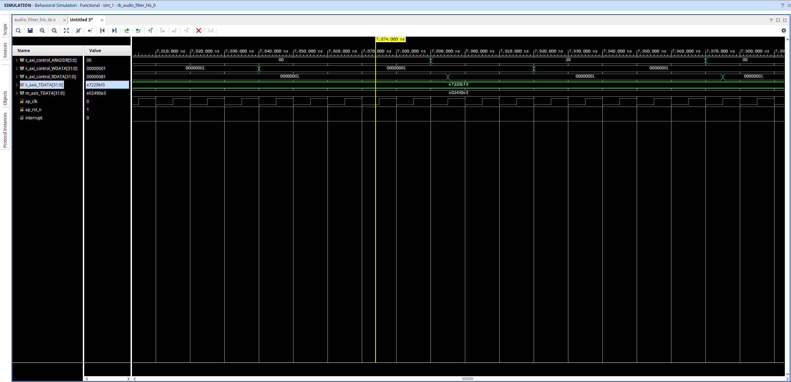

**Режим обходу (`bypass = 1`):**

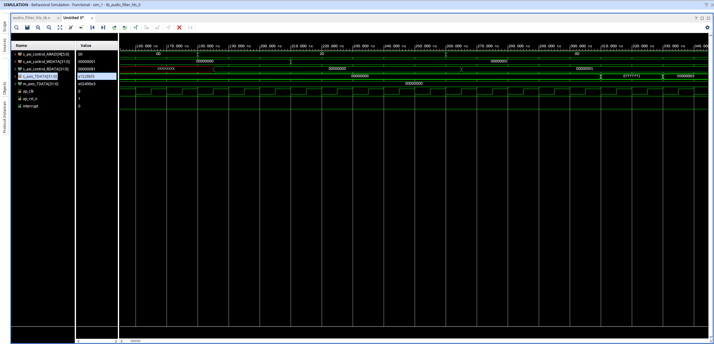

### 2.2. Перевірка даних AXI4-Stream

**Режим фільтрації (`bypass = 0`):**

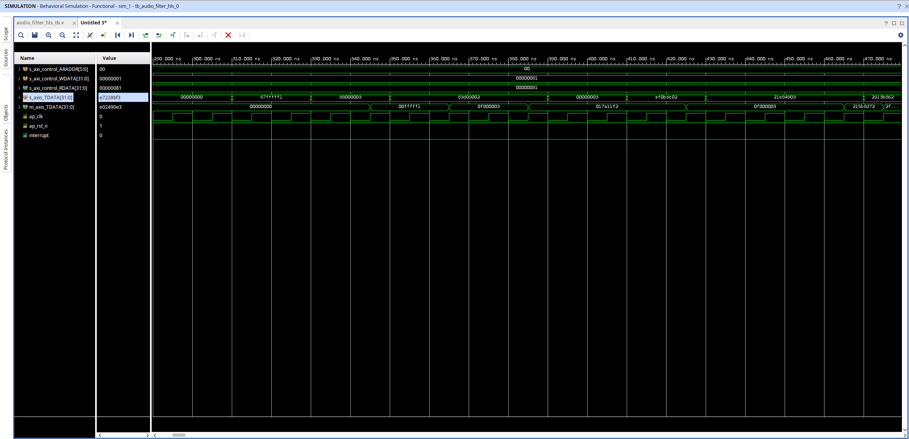

**Режим обходу (`bypass = 1`):**

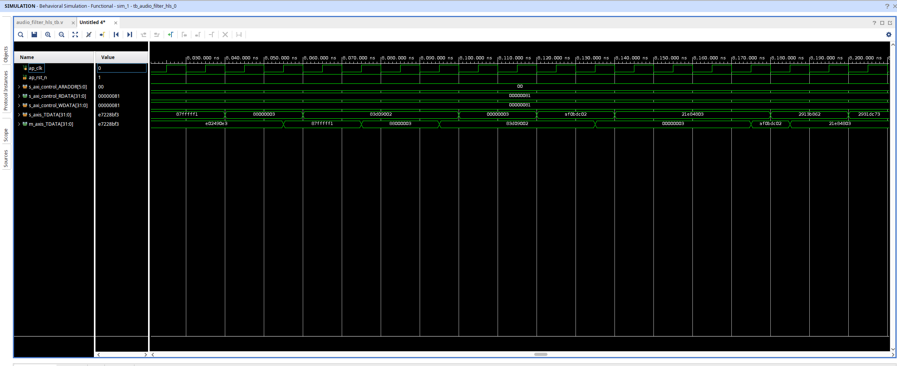

## 3. Додаткове завдання

Не виконано.

## 4. Розташування згенерованого IP-блоку

IP-блок, згенерований за допомогою Vivado HLS, знаходиться за таким шляхом:

```text
audio_formatter_tb/hls_component2/hls_component2/hls/impl/ip
```

## 5. Інтеграція IP-блоку з MicroBlaze

Було створено Block Design, який включає процесор **MicroBlaze** та розроблений IP-блок фільтрації.

Проєкт Vivado доступний у файлі:

`audio_formatter_tb.xpr`

### 5.1. Block Design

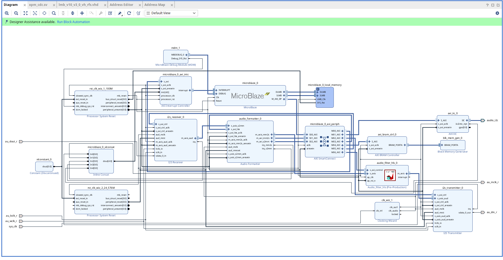

### 5.2. Карта пам'яті (Memory Map)

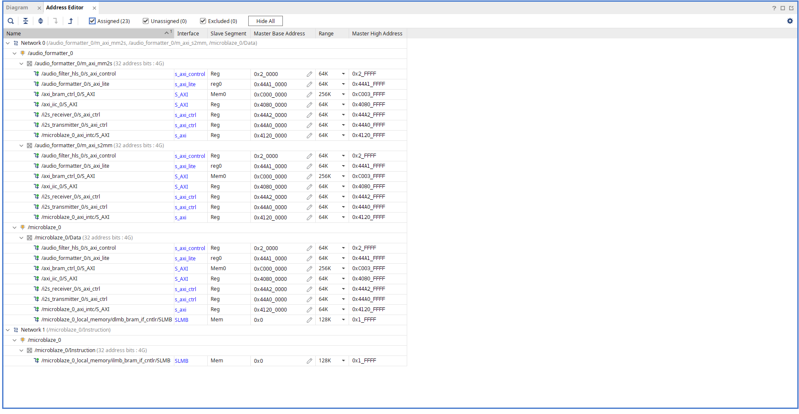

## 6. Симуляція повної системи

Для перевірки роботи всієї системи було створено тестове оточення, яке дозволяє моделювати передачу аудіоданих через інтерфейс I2S та їх обробку розробленим IP-блоком.

**Шлях до тестбенчу:**

`audio_formatter_tb/audio_formatter_tb.srcs/sim_1/new/tb_design_1_i2s.v`

Симуляція також доступна у проєкті Vivado:

`audio_formatter_tb.xpr`


### 6.1. Підготовка ELF-файлу для симуляції

Для використання ELF-файлу під час симуляції повної системи програмне забезпечення необхідно скомпілювати з увімкненим макросом **`BUILD_FOR_SIM=1`**.

Цей макрос дозволяє використовувати конфігурацію програмного забезпечення, призначену для симуляції.

**Налаштування макросу `BUILD_FOR_SIM=1`:**

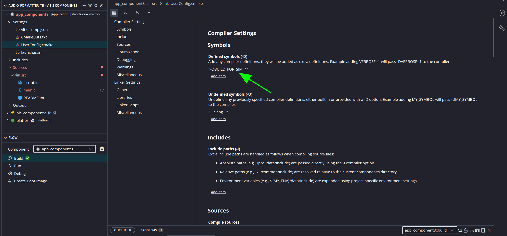


### 6.2. Симуляція в режимі обходу фільтра

**`bypass = 1` — фільтрація вимкнена:**

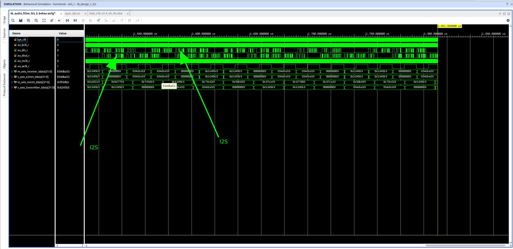

### 6.3. Симуляція з увімкненою фільтрацією

**`bypass = 0` — фільтрація увімкнена:**

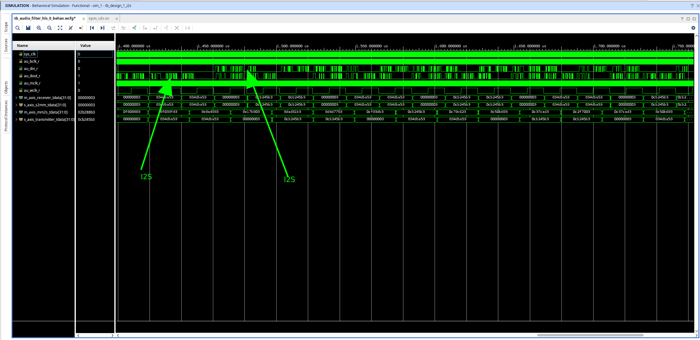

## 7. Результати синтезу та реалізації

Для оцінки апаратної реалізації проєкту наведено звіти часових характеристик (Timing Reports) та використання ресурсів FPGA (Utilization Report).

### 7.1. Часові характеристики після синтезу (Synthesis)

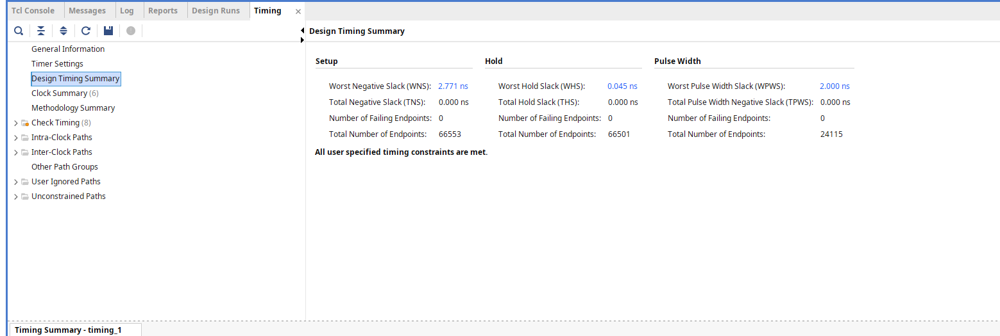

### 7.2. Часові характеристики після реалізації (Implementation)

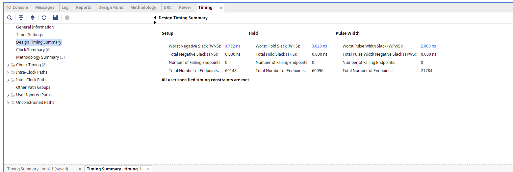


### 7.3. Використання ресурсів FPGA

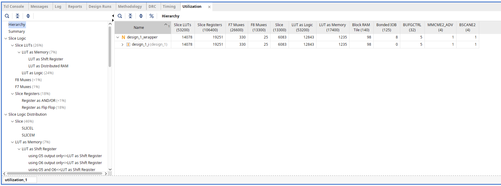

## 8. Тестування на реальному обладнанні

Роботу проєкту на фізичній FPGA-платі продемонстровано у відеозаписі.

Відео демонструє функціонування розробленої системи на реальному обладнанні.

Було додане через особистий кабінет.